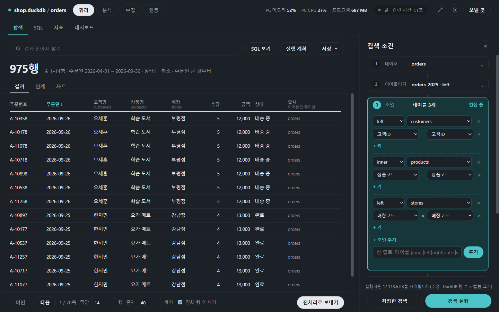
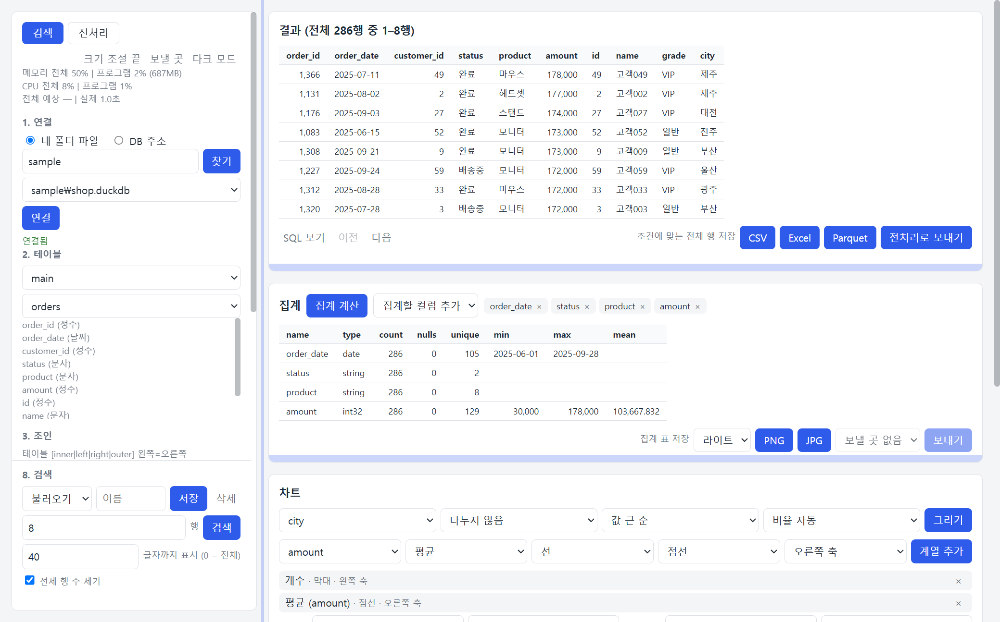

# 설정과 참고

[← README](../README.md) · [쿼리](query.md) · [분석](analysis.md) · [수집](collect.md) · [연동](integrations.md) · [설정과 참고](settings.md)

**한 줄 요약**: 화면 바꾸는 법, 작업이 얼마나 걸리는지 보는 법, 프로그램이 무엇을 기억하는지, 회사 DB 주소 모양을 모아 둔 곳입니다.

## 진행 상황과 취소

위쪽 줄 오른쪽에 `PC 메모리 51%`, `PC CPU 18%`, `프로그램 594 MB`, 그리고 `● 끝 예상 0.1초 · 걸린 시간 1.2초`처럼 지금 작업이 보입니다.

- 작업이 도는 동안 [취소]를 누르면 멈춥니다. 30분이 넘는 작업은 저절로 멈춥니다.
- **예상** 시간은 "행 수 × 지난번 비슷한 크기에서 한 행에 걸린 시간"으로 어림합니다. 처음에는 `—`이고, 몇 번 쓰면 생깁니다.
- 검색이 너무 오래 걸리면 [취소] 후 기간·조건을 좁히세요. PC 메모리가 90% 가까이 오르면 연결 카드의 **작업 메모리 상한**(DuckDB 파일만)을 정하세요.
- 회사 DB에 연결하면 계산은 DB 서버가 해서 PC 숫자는 거의 움직이지 않습니다.

## 화면 설정

| 하고 싶은 것 | 방법 |
|---|---|
| 밝은/어두운 화면 | 위쪽 줄 오른쪽 달·해 버튼(처음에는 Windows 설정을 따름) |
| 패널 너비·표·차트 높이 바꾸기 | 화살표 두 개 버튼 → 경계를 끌기(더블클릭은 기본 크기) → 다시 버튼 눌러 끄기. 바꾼 크기는 기억함 |
| 긴 목록에서 찾기 | 목록 칸을 누르고 글자 치기(항목이 8개보다 많을 때) |

창 크기를 바꾸면 배치가 바로 맞춰집니다. 좁으면 메모리·CPU 표시를 숨기고, 더 좁으면 패널이 아래로 내려갑니다.

## 안전하게 쓰기 (자세히)

| 걱정 | 프로그램이 하는 일 |
|---|---|
| 실수로 데이터를 망가뜨리면? | 검색·SQL은 읽기만 합니다(데이터를 바꾸는 문장은 막음). DB에 쓰는 일은 분석의 "새 테이블 만들기"와 수집의 적재뿐입니다. 회사 DB에는 읽기 전용 계정을 권합니다 |
| 비밀번호가 새면? | DB·Kafka 비밀번호는 메모리에만 두고 파일에 저장하지 않으며, 오류 문구에서도 가립니다. 토큰·키는 서비스마다 고른 방식으로만 둡니다 |
| 요금 폭탄 | 실행 전에 [처리 용량](query.md#탐색-오른쪽-패널-17번)과 [SQL 보기]로 확인하세요. [전체 행 수 세기]를 끄면 조회가 줄어듭니다 |
| 엑셀 파일의 악성 수식 | CSV·Excel로 저장할 때 `=`, `+`, `-`, `@`로 시작하는 값 앞에 `'`를 붙여 수식으로 실행되지 않게 합니다 |
| 몰래 밖으로 보내지 않나? | 보낼 곳·Slack 봇·GA4·AI를 설정하고 쓸 때만 그 서비스와 통신합니다. AI에는 데이터 값을 보내지 않습니다. 그 밖에는 인터넷으로 아무것도 보내지 않습니다 |
| AI가 이상한 SQL을 만들면? | 자동으로 실행하지 않고 같은 검사를 거친 뒤 사람이 확인하고 [실행]합니다 |
| 임시 파일 | `%TEMP%\ibis_search\` 아래에 만들고 다 쓰면 지웁니다. 이 프로그램이 만든 표시가 있는 폴더만 지웁니다 |
| 다른 프로그램의 접속 | 실행할 때마다 새 열쇠를 만들어 이 프로그램 창의 요청만 받습니다 |

## 기억되는 것

설정은 `%APPDATA%\ibis_search\` 폴더(파일 탐색기 주소창에 그대로 넣으면 열림)에 저장됩니다. 저장한 검색·SQL·전처리 구성·대시보드·수집 구성·예약, 보낼 곳, 업로드 기록, 화면 설정 등이 들어 있고 **비밀번호는 없습니다.** 파일을 지우면 그 내용만 처음 상태로 돌아가고, 덮어쓰기 전에는 `.bak`으로 하나 남겨 둡니다.

**PC를 바꿀 때**: 이 폴더를 통째로 복사하면 그대로 옮겨집니다. 단, "암호화해 저장"한 토큰은 새 PC에서 다시 입력하세요.

## DB별 드라이버

회사 DB 주소 모양입니다. 주소와 읽기 전용 계정은 보통 DB 담당자에게 받습니다. 필요한 드라이버가 없으면 프로그램이 설치 방법을 알려 줍니다.

| DB | 주소 예 |
|---|---|
| PostgreSQL / MySQL | `postgres://host:5432/db` / `mysql://host:3306/db` |
| MSSQL | `mssql://host:1433/db` ([ODBC Driver 17/18](https://learn.microsoft.com/sql/connect/odbc/download-odbc-driver-for-sql-server) 필요. 아이디·비밀번호를 비우면 Windows 로그인) |
| Oracle / ClickHouse / Trino | `oracle://host:1521/db` / `clickhouse://host:8123/db` / `trino://host:8080/catalog/schema` |
| Snowflake | `snowflake://계정/데이터베이스/스키마?warehouse=WH` |
| BigQuery | `bigquery://프로젝트/데이터셋` (처음 접속 때 Google 로그인) |
| Databricks / Athena | `databricks://?server_hostname=…&http_path=…` / `athena://?s3_staging_dir=s3://…&region_name=…` |
| DuckDB / SQLite 파일 | `duckdb://data.duckdb` / `sqlite://data.db` |

그 밖에 Druid, Exasol, Impala, Materialize, RisingWave, SingleStore도 됩니다. Spark·Flink는 Java가 필요하고 소스로 실행할 때만 씁니다.

**예**: 회사 Postgres 서버 `db.company.local`의 `sales` DB → 주소 `postgres://db.company.local:5432/sales`, 아이디·비밀번호는 칸에 따로(주소에 비밀번호를 쓰지 마세요).
